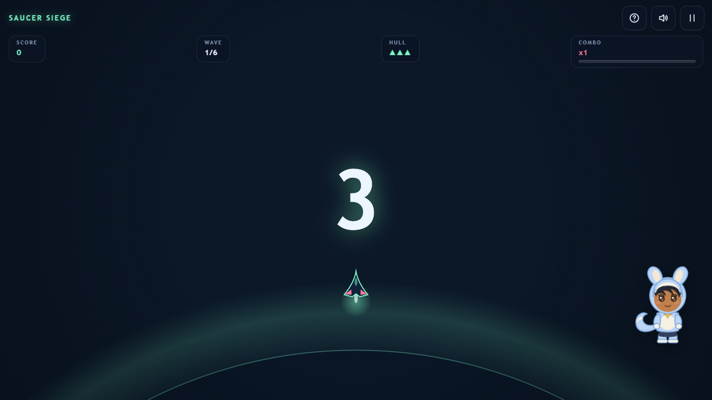

# SAUCER SIEGE

**Saucer waves are probing Sector 7. You are what's standing in the way.** A top-down arcade defense shooter — chain kills into a burning multiplier, grab shield and tri-shot pods, and drop the mothership before it drops you.

[▶ Play Saucer Siege](https://siddhant-pardeshi.github.io/saucer-siege/) — free, no install, no login. Phones and desktops.



## The pitch

A dart-ship, a dark sky, and six waves of saucers that do not respect the treaties. Scouts drift in firing rose bolts; bug swarms zigzag at your hull; abductors try to tractor-beam the power pods before you can. Every third wave a **mothership** fills the scope with radial bullet patterns and escort minions.

The game is the **combo meter**: kills within 2.5 seconds chain x2 up to x8, and taking a hit resets it. Aggression pays; trading does not.

## Debriefs: learn the bug classes

Every saucer on the field wears a **real bug class** — RaceCondition, SQLi, NullPointer, CSRF — and between waves your mission controller walks you through a **debrief**: one concept card about the class you just fought (what a race condition actually is, why parameterized queries beat escaping, what the padlock does and does not promise). Correct calls pay a wave bonus **and patch your hull (+1, up to four)**; a wrong call costs a hull heart — run out and the grid falls. Every answer gets a one-line explanation, and mastery is tracked in the menu's **Concepts** codex.

## Controls

| Action | Keyboard | Mouse | Touch |
| --- | --- | --- | --- |
| Move | `WASD` / arrows | — | Joystick |
| Fire (hold) | `Space` | Click / hold | FIRE button |

Your ship auto-aims at the nearest threat — the skill is positioning, spacing, and knowing which saucer to delete first.

- **Scouts** telegraph their bolts — strafe, don't sprint.
- **Bugs** die in one hit but arrive in numbers — keep moving in circles, not lines.
- **Abductors** go for the pods; killing one drops what it carried.
- **The mothership** spawns minions as it turns — clear the escort before the boss.
- Full guide: [docs/HOW_TO_PLAY.md](docs/HOW_TO_PLAY.md).

## Pip, your mission controller

The character in the corner is Pip — warm voice on the comms. They brief you, cheer your combo streaks with real animations, call the mothership, and get drowsy when you pause. Hide or mute them in Settings. Rig details: [docs/mascot-guide.md](docs/mascot-guide.md).

## Accessibility & settings

Volume sliders and mute (`M`), quality tiers, reduced motion, camera-shake toggle, hideable mascot, fullscreen, keyboard-playable menus, touch targets ≥ 44px. Fully playable muted — every effect has a visual counterpart.

## Under the hood

One shared game kit, zero downloaded assets: three-layer parallax starfield, nebula blobs and a planet horizon drawn with canvas paths; saucers, pods and the mothership are vector geometry; the soundtrack — 92 BPM space pads, a 128 BPM battle groove with an intensity lead that climbs per wave — is synthesized live with WebAudio. Personal best lives in localStorage.

- [docs/HOW_TO_PLAY.md](docs/HOW_TO_PLAY.md)
- [docs/mascot-guide.md](docs/mascot-guide.md)
- [docs/QA.md](docs/QA.md)

## Run it locally

```bash
python -m http.server 8000
# open http://localhost:8000
```

## License

MIT — see [LICENSE](LICENSE). All code, art, characters and music are original work.

Inspired by classic arcade defense games. Not affiliated with or endorsed by any studio or publisher.
